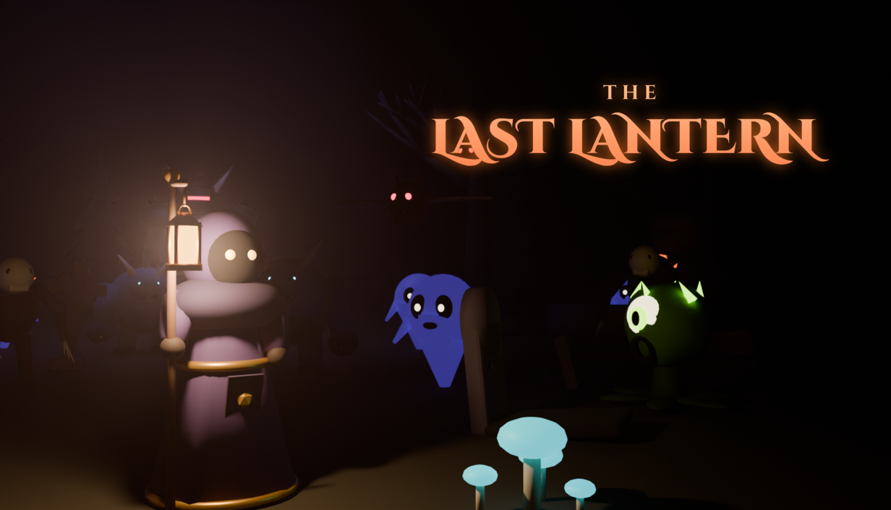

# The Last Lantern

*The night is endless. Your light is not.*

A 3D **bullet-heaven roguelite**, in the genre of *Vampire Survivors* and *Brotato*, built in **Godot 4.3**, with every model made in **Blender**.

You are the last lantern-bearer in an endless night. Shadow creatures close in from the fog while your weapons fire on their own. Gather soul-gems, level up, combine weapons and relics into a build, and survive 12 minutes until the Hollow King rises. Defeat him and dawn breaks, or keep going into the Endless Night.



## Features

- **Real-time lighting is the core of the game.** Your lantern is a dynamic light that casts shadows through volumetric fog. Enemies come out of the darkness with glowing eyes, and those inside your light take bonus damage.
- **7 weapons** with 6 levels each: Ember Bolt, Sun Halo, Lantern Pulse, Storm Arc, Moon Scythe, Lantern Seeds, Frost Shards.
- **12 relics (passives)**, plus chests, elites, horde events, and pickups (heal, magnet, flashbang).
- **7 playable Keepers**, each with a different starting weapon and stats. Six of them unlock through achievements.
- **4 boss fights**: the Ashen Warden, the Hollow Choir, the Warden reborn, and the Hollow King. Bosses use telegraphed dashes, bullet rings, spirals, and summons.
- **Meta-progression**: the Sanctum shop spends Embers earned in each run on permanent upgrades.
- **14 achievements**, already wired to Steam.
- **Endless mode** after the victory.
- **Full controller support**, so it is ready for Steam Deck.
- Settings for SFX/music volume, fullscreen, V-Sync, screen shake, damage numbers, and **graphics quality (Low/Medium/High)** for low-end PCs and Steam Deck.
- **Every asset is original and generated from scripts in this repo.** The models come from Blender, the music and sound effects are synthesized, and the fonts are SIL Open Font License. There is nothing to license and nothing to get flagged.

## Play / edit it

1. Install **Godot 4.3** (free, <https://godotengine.org/download>). Use the standard build, not .NET.
2. In Godot, choose **Import** and pick this folder's `project.godot`.
3. Press **F5** to play.

Controls: **WASD / arrow keys / left stick** to move. Weapons fire automatically. **Esc / P / Start** pauses. **1–4** pick level-up cards. **R / X** rerolls. **F11** toggles fullscreen.

## Build the game for Steam

In Godot, go to **Project → Export…**. The **Windows** and **Linux** presets are already set up. Install the export templates when Godot asks (one click), then click **Export Project**:

- Windows: `build/windows/TheLastLantern.exe` + `TheLastLantern.pck`
- Linux / Steam Deck: `build/linux/TheLastLantern.x86_64` + `TheLastLantern.pck`

Command-line equivalent:

```bash
godot --headless --export-release "Windows" build/windows/TheLastLantern.exe
godot --headless --export-release "Linux"   build/linux/TheLastLantern.x86_64
```

## Steam release checklist

1. **Steamworks account.** Sign up at <https://partner.steamgames.com>. The fee is **$100 per game**, recouped after $1,000 in sales.
2. **Steam achievements: install GodotSteam.** In Godot, open the **AssetLib** tab, search **"GodotSteam"**, and install the GDExtension version for Godot 4.3. Put a `steam_appid.txt` containing your App ID next to the exported `.exe` for local testing. `scripts/save.gd` already detects GodotSteam and reports achievements. Without it, the game simply runs without Steam.
3. **Create the achievements** in Steamworks → *Stats & Achievements*, using these **exact API names**:
   `ACH_FIRST_NIGHT, ACH_SURVIVE_5, ACH_SURVIVE_10, ACH_BOSS, ACH_DAWN, ACH_ENDLESS_20, ACH_KILLS_1000, ACH_KILLS_TOTAL, ACH_LEVEL_30, ACH_MAX_WEAPON, ACH_ARSENAL, ACH_RICH, ACH_NO_HIT_3, ACH_ALL_CHARS`
   The display names and descriptions are in `scripts/data.gd` → `ACHIEVEMENTS`.
4. **Store art is already made.** It's in the `store/` folder, rendered in Blender and sized exactly as Steam requires:

   | File | Steam slot |
   |---|---|
   | `capsule_header_920x430.png` | Header capsule |
   | `capsule_small_462x174.png` | Small capsule |
   | `capsule_main_1232x706.png` | Main capsule |
   | `capsule_vertical_748x896.png` | Vertical capsule |
   | `page_background_1438x810.png` | Page background |
   | `library_capsule_600x900.png` | Library capsule |
   | `library_hero_3840x1240.png` | Library hero |
   | `library_logo_1280x720.png` | Library logo |
   | `screenshots/*.png` | Store screenshots (1920×1080) |

5. **Upload the builds** with SteamPipe (steamcmd from the Steamworks SDK). Use one depot for `build/windows` and one for `build/linux`. Set the launch options to `TheLastLantern.exe` (Windows) and `TheLastLantern.x86_64` (Linux).
6. **Put the "Coming Soon" page up early.** It must be live for at least 2 weeks before release, and **wishlists before launch are the biggest predictor of sales**.
7. **Price:** this genre typically sells for **$2.99–$4.99**. A 10–20% launch discount helps.
8. Before launch, change `application/company_name` in `export_presets.cfg` to your studio name.

### Marketing that works for this genre
- Short gameplay clips of the late-game chaos (hundreds of enemies, the lantern light, boss fights) on TikTok, YouTube Shorts, and Reddit (r/IndieGaming, r/roguelites, r/godot).
- **Steam Next Fest** with a free demo. A demo build can stop at the first boss (change `DAWN_TIME` and `BOSS_SCHEDULE` in `scripts/data.gd`).
- Send keys to YouTubers who cover survivors-likes. The genre has a big, loyal audience.

No game is guaranteed to sell, but a polished trailer and a wishlist campaign give it a real chance.

## Regenerating assets

Everything in `assets/` is generated, so you can tweak and rebuild it:

```bash
# 3D models (Blender 4.2; or: pip install bpy==4.2.0 under Python 3.11)
blender -b -P tools/blender/build_assets.py -- assets/models

# Music + sound effects (Python 3 + numpy + ffmpeg)
python tools/audio/gen_audio.py assets/audio

# Steam key art (Cycles) and store images (ImageMagick)
blender -b -P tools/blender/render_keyart.py -- /tmp/wide.png 2464 1412 64 wide
blender -b -P tools/blender/render_keyart.py -- /tmp/tall.png 1200 1440 64 tall
blender -b -P tools/blender/render_keyart.py -- /tmp/hero.png 3840 1240 40 hero
tools/store/make_store_art.sh /tmp/wide.png /tmp/tall.png /tmp/hero.png <folder with Cinzel TTFs>
```

## Testing

A built-in bot can play the game headlessly and print a balance report:

```bash
godot --headless --path . -- --autotest                 # plays one run, prints stats each minute
godot --headless --path . -- --autotest --god --char=reaper
godot --path . -- --menushots=/tmp/shots               # captures menu screenshots
```

## Project layout

```
project.godot           Godot project
scenes/main.tscn        Entry scene
scripts/main.gd         Game flow (menu, runs, pause, test modes)
scripts/world.gd        3D world: lighting, player, enemies, bosses, weapons, spawning, effects
scripts/ui.gd           All menus, HUD, level-up cards, shop, achievements, settings
scripts/data.gd         ALL balance numbers and content (weapons, relics, enemies, bosses, characters, shop)
scripts/save.gd         Save file, settings, achievements, Steam bridge
scripts/audio.gd        Sound effects pool and music crossfading
scripts/item_icon.gd    Vector-drawn weapon/relic icons
assets/                 Models (.glb), audio, fonts, icon
tools/                  Blender, audio and store-art generators
store/                  Steam store images
```
